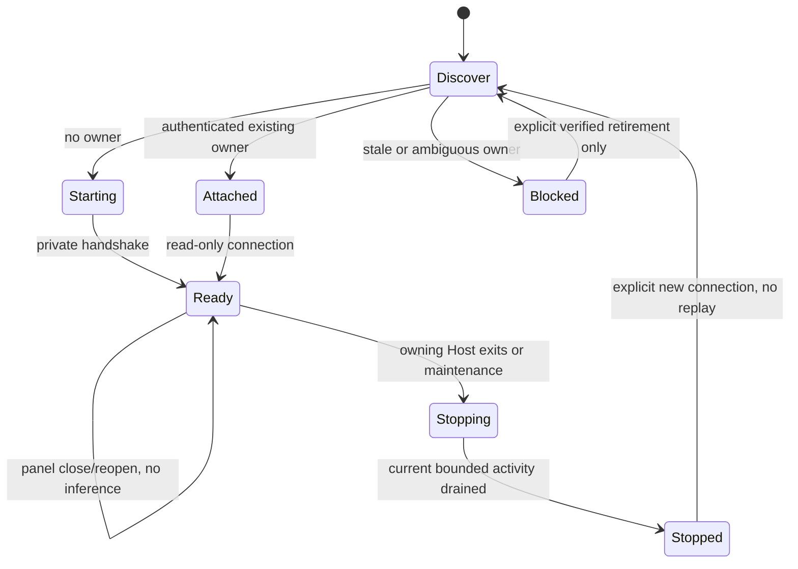

# Desktop-N1 lifecycle contract

One physical database has one scheduler service, guarded by an exclusive owner marker. Discovery contains a versioned named-pipe/Unix-socket address and a random capability in a private local file; the renderer never receives that file, token, process path or database path. All business requests are typed, bounded JSON. The Desktop Host bridges its owner-authenticated Connection to the service; browsers cannot reach an OS pipe directly.

Opening/reopening a panel or reconnecting only reads. Starting a service registers the two fixed nodes but never pumps. Explicit start/send/resume/pump operations alone wake authorized work. Legacy CLI schedulers reject a live native ownership marker; CLI/MCP clients use the same service. Missing/ambiguous stale ownership is reported, not silently deleted. SDK and business quarantine markers are never removed by instance discovery.

Closing the panel does not stop its service. Disabling the owning plugin or ending the owning Host requests bounded graceful shutdown: stop new writes/wakes, wait for the current bounded SDK activity, retain unknown execution if necessary. Do not SIGKILL an unproved SDK activity and immediately reuse its root. A borrowed service is never stopped by an attaching Host. Parent IPC loss starts the same shutdown path. Restart does not resume discussion automatically.

No new model tools, schema migration, remote access, credential persistence or maintenance UI in N1. Per-stage tests cover authentication, ownership, duplicate start, stale discovery, no inference on connect, response loss, parent disconnect and stop. N2 adds native business interaction only after this gate.

