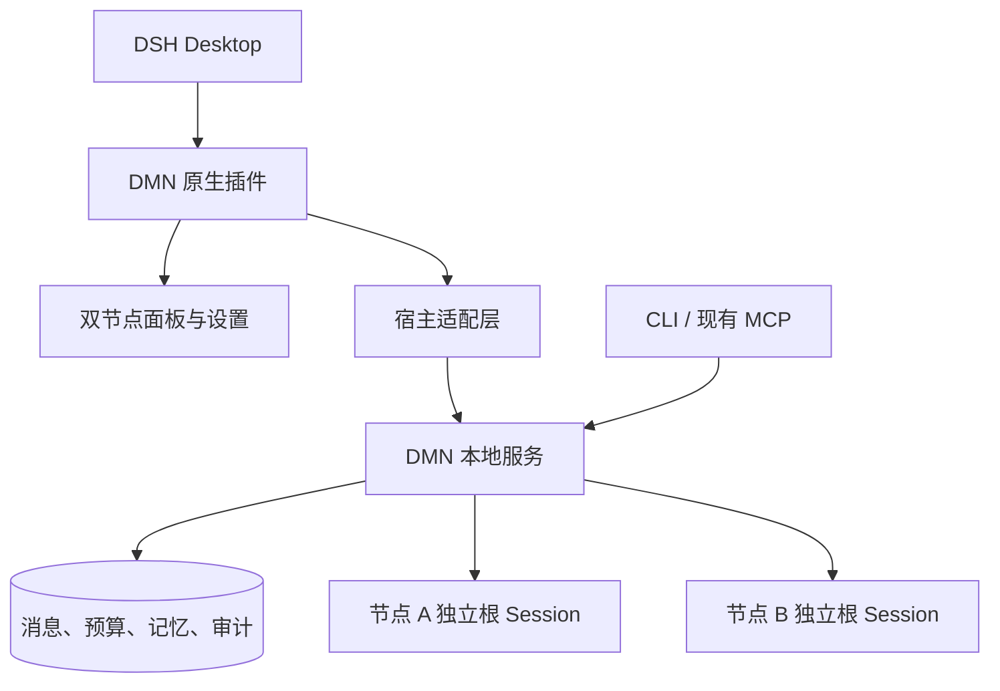

# Desktop-N — DSH Desktop 完整原生插件开发计划

日期：2026-10-27。状态：N0–N5 验收通过，v0.1.0 完整源码包独立安装通过；保持 P0–P5 历史记录与 P6–P8 原编号，不启动 P6。详见 [N5 报告](DESKTOP_N5_ACCEPTANCE.md)。

## 目标与路线位置

将 Desktop-N 安排在 P5 审查问题修复及回归之后、P6 多 Provider 扩展之前。用户在 DSH Desktop 内完成双节点交流、讨论控制及运行管理；正式交付不依赖手工修改配置或另开 Web 页面。

保留现有 MCP 接入与独立 Web 入口作为兼容能力；原生面板不是现有 MCP 配置的别名，外链页面也不算原生面板。Desktop 面板、设置、进程管理与安装分发能力必须先核对目标版本的官方接口。

P5 审查前置项（2026-10-27 已通过 P5-H1 修复及回归，见 [修复报告](P5_H1_PATH_AND_LEGACY.md)；N0 已通过）：

1. 拒绝悬空数据库符号链接，统一数据库、客户端登记和 Runtime 路径身份，防止路径别名绕过活跃客户端检查。
2. 对全部支持的旧 Schema 检查 running 轮次，定义旧轮次升级后的隔离规则，避免备份接收不可对账的运行状态。

以上修复须保留 P5 测试与新增复现回归，不能仅修改验收摘要。

## 架构决策与边界

优先评估“Desktop 原生面板 + 独立 DMN 本地服务”。现有 OperatorService、Gateway、TopicManager、Runner、MemoryManager 为业务基础，Desktop 插件负责交互、设置与服务生命周期；DSH SDK 继续驱动固定根 Session。不得引入 Subagent 或复制一套不受现有预算约束的模型调用路径。

- 明确界面按钮直接提交类型化操作，Desktop 聊天模型不作为必经中介，不让转述改变收件人、预算或授权。
- 一个数据实例由明确的服务进程拥有调度权；CLI、MCP、面板的实例发现、连接与维护边界必须先定义。维护工具在停机屏障下操作，不向模型公开文件备份能力。
- 通信优先使用官方宿主 IPC 或本地管道。若只能采用回环 HTTP，另行定义实例认证、来源验证、协议版本及启动握手，不能原样公开现有 Web 接口。
- 发送者、话题、回复关系和记忆 owner 由服务端绑定。前端不得直写数据库、提交任意 Session 或通过路径参数越权。
- 模型节点不能获得面板管理、跨节点私有记忆、备份、恢复、扩大预算或邀请参与者的权限。

取舍：仅使用 MCP 已可完成工具接入，但不能交付专属原生面板和完整安装体验；直接深改 Desktop 核心会增加版本耦合。先验证正式扩展接口，再复用业务服务，可以减少重复实现与权限漂移。若官方接口不足，必须明确能力缺口及替代方案，不静默使用内部接口。

## Desktop-N0 — 官方接口与最小原型

工作项：

1. 记录实际 Desktop、SDK、Runtime、Cordis 版本及目标平台，核对官方插件注册、面板/视图、设置、命令、事件和资源加载接口。
2. 核对凭据引用、子进程管理、安装、更新及卸载机制。
3. 明确渲染进程与宿主权限、消息正文安全渲染和服务通信边界。
4. 制作最小插件：加载一个界面，通过宿主调用只读接口，然后卸载；不调用模型。
5. 若缺乏面板 API，记录缺口，比较受支持的独立窗口方案与另立 Desktop 核心改动任务；本计划不自动授权修改 DSH 核心。

交付：版本/能力矩阵、官方资料引用、架构决策、最小原型及加载/卸载证据。

门禁：目标版本上真实加载、显示、只读调用和卸载通过；未确认能力标记 BLOCKED/NOT_RUN。通过后才确定 UI 技术与服务通信选型。

## Desktop-N1 — 服务所有权与生命周期

工作项：

1. 建立统一服务入口、实例发现、启动握手、协议版本与数据实例身份。
2. 定义 Desktop、CLI、MCP 的连接方式，避免多个调度器因重复打开面板而启动。
3. 明确推理期间关闭面板、退出 Desktop、服务崩溃与宿主重启的处理规则。
4. 实现受控退出、断线重连、错误上报及维护状态；保留未知结果隔离，不重置预算。

默认建议：关闭面板仅断开界面；宿主退出按既定流程停止所拥有的服务；重启不自动重放未知任务或恢复讨论。后台常驻必须是单独的显式设置。

交付：生命周期状态图、类型化通信契约、服务管理实现、崩溃/重连测试。

门禁：重复打开不重复启动；掉线不重复提交；宿主重启能识别遗留实例、锁和未知结果；不强杀未证明停止的 SDK 后马上启动同节点新活动。

## Desktop-N2 — 原生双节点交互

工作项：

1. 节点名称、职责、模型及真实运行状态；明确选定收件人。
2. 定向交流、节点回复、节点间讨论及有方向标识的消息时间线。
3. 话题列表、预算、截止时间、执行进度及暂停/恢复/结束操作。
4. 历史分页、请求幂等、响应丢失后的恢复、准确的错误和静默/拒绝/未知状态。
5. 键盘操作、窄窗口布局和基本无障碍支持；正文不能执行 HTML、脚本或伪造宿主指令。

交付：原生面板、服务适配、契约测试、模拟浏览器及真实 Desktop 操作证据。

门禁：A/B 定向消息仅唤醒目标节点；回复关联实际输入与完成轮次；刷新、重复点击和关闭重开不重复执行；查询和面板加载不调用模型；旧 epoch 结果不能越权产生效果。

## Desktop-N3 — 诊断与受控恢复

工作项：

1. 只读诊断展示队列、轮次、错误类别、死信、完成证明类别、预算及实际用量。
2. 提供显式对账入口；人工放弃确认具体 turnId 并填写原因，操作身份由宿主绑定并写审计。
3. 接入停机备份、校验和原位恢复的管理流程，显示目标实例、阻塞条件与处理结果。
4. 将只读与维护能力分开授权，不因消息正文要求而触发对账、drop、清锁或文件操作。

交付：管理界面、授权/审计契约、故障注入与恢复演练。

门禁：不暴露私有 Prompt、模型原文历史或跨节点记忆；忙碌/未知证明不被绕过；审计失败时效果回滚；活跃客户端阻止备份，恢复途中中断保持隔离。

## Desktop-N4 — 安装、配置、升级与卸载

工作项：

1. 提供安装包、兼容版本检查与首次配置流程，校验 Desktop、Node、SDK 和插件协议。
2. 通过受支持的安全机制引用凭据；配置模型、数据目录、日志目录及已有实例。
3. 提供只读连通性检查；实际模型探测若收费，须显式说明并授权。
4. 明确旧数据迁移、成套备份、升级失败回退与匹配代码/数据版本。
5. 卸载停止插件拥有的进程并移除插件配置，默认保留业务数据；删除消息、记忆及 Session 历史必须作为独立授权操作。

交付：安装/升级包、首次使用界面、支持矩阵、卸载与回滚说明。

门禁：新环境可安装，已有配置不被覆盖；旧数据安全升级并可恢复；凭据不写入仓库、普通配置、消息或日志；卸载不误删历史。

## Desktop-N5 — 真实 Desktop 验收与发布

发布门禁：

1. 全新安装发现两个节点，未经授权时零模型调用。
2. 分别向 A/B 发送输入，回复来自正确的固定根会话；私有记忆不串线。
3. 重复点击、响应丢失、面板关闭及宿主重启不重复执行。
4. 讨论达到预算停止；暂停后的旧结果不继续产生效果，恢复不重置额度。
5. SDK/服务崩溃、遗留锁和未知轮次可诊断并受控处理。
6. 成套备份及原位恢复后保留原根会话、幂等记录和授权预算。
7. 提示注入、脚本正文、伪造身份及路径参数不能获得额外权限。
8. 安装、升级、回退与卸载经过真实 Desktop 操作验证。

交付：发布包、可复现验收报告、用户手册、支持矩阵及已知限制。模拟测试、真实模型、真实 Desktop、故障与耐久结果分别标记；预先确定真实调用次数、Token/估算费用预算和观察时长。不能用单次演示替代长稳，也不能声称任意故障自愈。

## 范围与推进规则

- 第一版仅覆盖现有双节点，不加入第三节点、跨 Provider、语音、复杂动画、远程多用户或跨节点私有记忆浏览；分别衔接 P6、P7、P8。
- 原生插件安装与本地权限在 Desktop-N 内完成；通用部署与远程模式仍归 P8，避免将当前本地信任入口直接远程开放。
- P5 修复完成后，依次推进 N0→N1→N2→N3→N4→N5，不同时启动多个里程碑，不使用 Subagent。
- 每阶段先契约与测试，再必要持久化、运行时及界面集成。任何扩大权限或 Desktop 核心修改需另行明确范围。
- N0 之前不承诺具体 UI/API 技术；工期在能力验证后结合平台、接口和验收资源确定。
